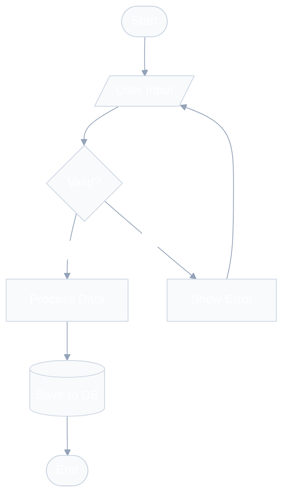
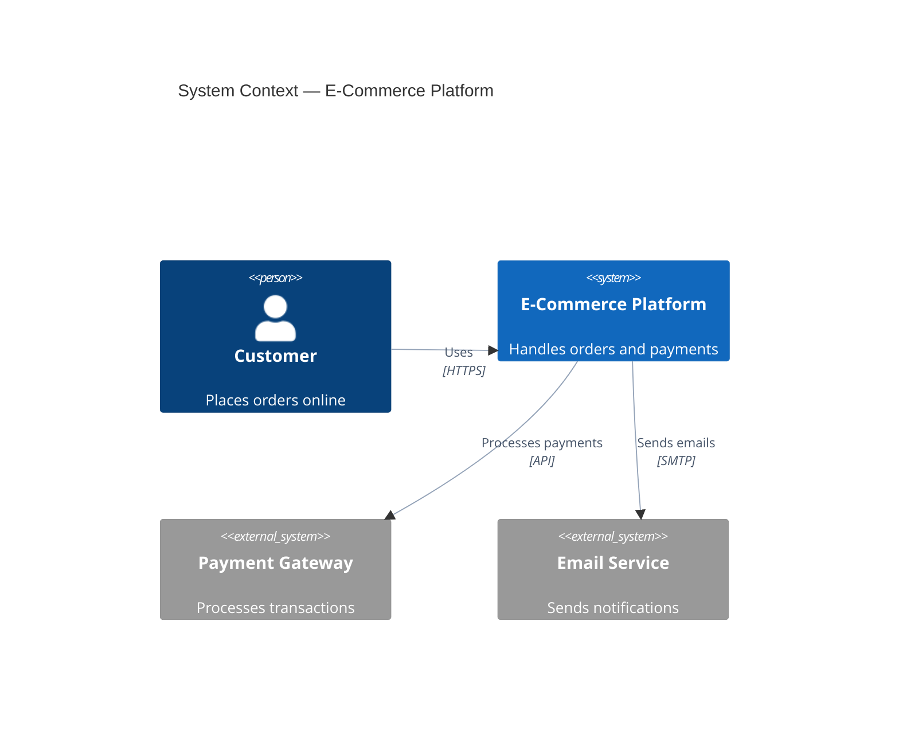

# Mermaid — Golden Rules and Palettes

Five non-negotiable rules. Every diagram MUST respect them.

## Rule 1 — Always use an init directive

NEVER create a diagram without `%%{init}` or YAML frontmatter. Default Mermaid produces harsh black lines and generic colors.

### General palette (flowchart, sequence, state, class, ERD)

```
%%{init: {'theme': 'base', 'themeVariables': {
  'primaryColor': '#4f46e5', 'primaryTextColor': '#ffffff',
  'primaryBorderColor': '#3730a3', 'lineColor': '#94a3b8',
  'secondaryColor': '#10b981', 'tertiaryColor': '#f59e0b',
  'background': '#ffffff', 'mainBkg': '#f8fafc',
  'nodeBorder': '#cbd5e1', 'clusterBkg': '#f1f5f9',
  'clusterBorder': '#e2e8f0', 'titleColor': '#1e293b',
  'edgeLabelBackground': '#ffffff', 'textColor': '#334155'
}}}%%
```

### Font warning

Do NOT set `fontFamily` in theme variables. The Mermaid default font (`trebuchet ms, verdana, arial, sans-serif`) works everywhere. Setting `system-ui`, `Segoe UI`, or `-apple-system` renders as Times New Roman in headless Chromium (used by `mmdc`).

### C4 diagrams

See dedicated section in `c4-architecture.md`.

### Architecture-beta (AWS, GCP, Azure)

See dedicated section in `aws-architecture.md`.

## Rule 2 — Soft lines, never harsh black

Single biggest visual improvement: `lineColor: '#94a3b8'` (slate-400) instead of default black.

For dark themes use `lineColor: '#64748b'` (slate-500).

## Rule 3 — Limit density

- Maximum 15 nodes per diagram (fewer is better)
- Use `subgraph` or boundaries for whitespace and visual grouping
- Prefer `LR` for process flows (reads more naturally)
- Use invisible links (`A ~~~ B`) to add spacing when cramped

## Rule 4 — Meaningful labels and consistent style

- Node IDs: camelCase (`orderService`, not `s1` or `os`)
- Labels: short, clear natural language (`[Order Service]`)
- Arrows: action verbs with protocol info (`"Sends order via gRPC"`)
- Descriptions: one-line, role-focused (`"Handles order lifecycle"`)

## Rule 5 — Color harmony over color variety

Max 3-4 colors per diagram. Map color to meaning:

- **Blue tones** (`#4f46e5`, `#3b82f6`) — primary systems, internal services
- **Green tones** (`#10b981`, `#059669`) — success states, data stores
- **Amber tones** (`#f59e0b`, `#d97706`) — external systems, warnings
- **Slate tones** (`#64748b`, `#94a3b8`) — lines, borders, secondary elements
- **Red tones** (`#ef4444`) — errors ONLY, never as decoration

## Quick reference — examples

### Flowchart with professional styling



### C4 Context with mandatory styling



### Architecture-beta (AWS with Iconify icons)

```mermaid
architecture-beta
    group vpc(logos:aws-vpc)[VPC]

    service api(logos:aws-api-gateway)[API Gateway] in vpc
    service lambda(logos:aws-lambda)[Lambda] in vpc
    service db(logos:aws-dynamodb)[DynamoDB] in vpc
    service s3(logos:aws-s3)[S3 Bucket]

    api:R --> L:lambda
    lambda:R --> L:db
    lambda:B --> T:s3
```



Architecture-beta with `logos:*` icons requires icon pack registration. When rendering with the render script, use `--icons logos`. If rendering in a markdown viewer that doesn't support icon packs, fall back to built-in icons (`cloud`, `database`, `disk`, `server`, `internet`).
